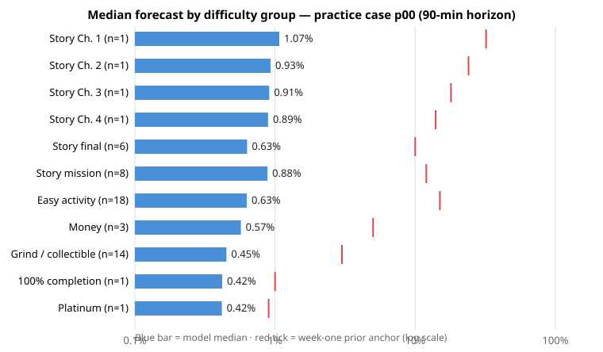

# GTA VI Trophy Rarity Forecast — Methodology

Entry for make.fun's `gta6-trophy-rarity-forecast-01`: forecast, for every
Grand Theft Auto VI PlayStation 5 trophy, its earn rate on Exophase at
2026-11-26T00:00:00Z, as five quantiles (5/25/50/75/95%). The entry program
is `main.py` (Python 3.13 standard library only, deterministic, ~0.08 s per
case). This document explains the model, its calibration, and how it was
validated.

## 1. The object being forecast

An Exophase earn rate is a ratio, not a primitive:

```
r_i(t) = 100 * E_i(t) / P(t)
```

`P(t)` is the number of players Exophase tracks for the game, `E_i(t)` the
number of them who hold trophy `i`. Two forces move every rate, in opposite
directions:

- **Dilution.** New players join the tracked set holding almost nothing, so
  each Exophase refresh drags rates down. Exophase refreshes a game's counts
  on its own schedule, hours apart — not continuously.
- **Progression.** The players already tracked keep playing, so story and
  easy-activity trophies climb as the week goes on.

A model that fits curves to the rates alone confuses the two. This entry
works in **counts**, per trophy, and blends three views of the median, all
on the logit scale.

## 2. The one hard fact: launch night's first refresh

The practice cases straddle Exophase's first refresh, and its totals are
public in the case files:

| | Before (2026-11-19 04:00Z) | After (04:30Z) |
|---|---|---|
| Players tracked | 638 | 3,868 |
| Trophies earned (all 55) | 943 | 4,276 |
| Trophies per tracked player | 1.48 | 1.11 |

Every rate but the one at 100% fell. The arithmetic that matters:

- New players: 3,868 − 638 = **3,230**.
- New trophies earned: 4,276 − 943 = **3,333** — about **1.03 per new
  player**.
- The 100% trophy ("Just Like Paradise" — complete the first mission) is
  held by every tracked player, so it absorbed **3,230** of those 3,333
  new earns.
- That leaves **103 new earns across the other 54 trophies** — about
  **0.03 trophies per new player**.

A new cohort is, to first order, fresh players who have only finished the
first mission. Any model that gives a new cohort a 55–70% earn rate on
every trophy — the naive "new players are like old players, just a bit
behind" assumption — is wrong by an order of magnitude on launch night,
and wrong in the same direction for every later refresh, only less so.

## 3. The model

### 3.1 Distinct refresh states

Consecutive identical reads are one state: Exophase only changes counts on
a refresh. All fits run over distinct states, not raw reads.

### 3.2 Players tracked at the target

`ln P` is fitted by weighted least squares against `ln(1 + hours since
2026-11-19T00:00:00Z)`, weights = state duration, and read at the target.
With a flat history (no growth signal — the practice cases), the fallback
is a refresh expectation: a refresh arrives as a Poisson process with mean
interval 6 h, and an early refresh multiplies players tracked ~6×
(638 → 3,868). `P_target` is capped at 20× the last value and 1,000,000.

### 3.3 Three views of the median

**Trend.** A weighted least-squares line of `logit(rate)` on
`ln(1 + hours since release)` over the distinct states, weights
`sqrt(players tracked)`. The slope is shrunk toward the trophy's
difficulty-group median slope and capped at ±3 per log-time unit.

**Structural (dilution floor).** Earned counts carried forward:

```
E_target = E_last + (P_target − P_last) * q_i
r_struct = 100 * E_target / P_target
```

`q_i` is the new-cohort earn rate for the trophy, measured from the
history's own refresh events: `q_i = (E_after − E_before) / (P_after −
P_before)` per refresh, weighted by the player jump, shrunk toward the
budget default when jumps are small. Where no refresh exists in history,
`q_i` falls back to the **budget model**: a new cohort earns ~1.03
trophies per player, the first-mission trophy takes ~1.00, so ~0.03 per
player is left for the other trophies, allocated by the launch cohort's
earned shares with a progression skew — story ×3, easy ×1.5, grind ×0.3,
money ×0.5, platinum/completion ×0.2 — because new players are at the
start of the game.

**Prior.** A difficulty-group week-one anchor (Section 4). Its weight
grows with the horizon and shrinks when the trend fit is confident.

**Blend.** On the logit scale: `w_trend = 0.20 + 0.45·conf`,
`w_struct = 0.45 − 0.15·conf`, the rest to the prior (horizon-scaled).
`conf` comes from the number of distinct states and the fit residual.
A flat history carries no trend signal at all, so the structural model
takes over there; a rich history lets the trend dominate.

### 3.4 Spread

```
s = sqrt(s_fit² + 0.35² + s_event² + (0.5·sqrt(horizon_days))² + (0.3·w_prior)²)
```

- `s_fit`: the trend fit's residual (floor 0.18, cap 1.0; 0.45 with fewer
  than 3 points).
- `0.35`: refresh timing — the answer is the last refresh before the
  target.
- `s_event`: the bimodality of a short window. A refresh in the window
  drops most rates ~1.5 logit; no refresh leaves them flat. The spread of
  that Bernoulli mixture is `sqrt(p(1−p)) · 1.5`, where `p` is the
  refresh probability in the window. It peaks when a refresh is a coin
  flip and vanishes when one is certain, as over a 4.5-day horizon.
- `0.5·sqrt(days)`: the house baseline's random walk.
- Quantiles are the median logit plus the standard normal's quantile at
  each level (−1.645, −0.674, 0, 0.674, 1.645) times `s`.

A trophy everyone already holds (last rate ≥ 99.5%) stays held: median
99.99%, narrow spread 0.12 logit.

## 4. Difficulty groups and week-one priors

Trophies are classified from tier + description. The week-one prior
medians are calibrated on GTA V's lifetime rarity (PSNProfiles, share of
owners): first story trophy ~48%, final mission ~19%, platinum ~5.35% of
owners, 100% completion ~5–6%, "Solid Gold, Baby!" (70 gold medals)
~6.9%, and ~5% of PlayStation players ever finish the full set (150+
hours). Launch-week rates sit well below lifetime rates — most week-one
players are still in the opening chapters — so the priors are scaled down
to launch-week progression: story chapters fall from ~32% (Ch. 1) to ~10%
(final mission), easy first-time activities ~15%, grinds ~3%, money
trophies ~5%, platinum ~0.9%, 100% completion ~1.0%.

| Group | Trophies | Prior median | How classified |
|---|---|---|---|
| platinum | 1 | 0.9% | tier = platinum |
| completion | 1 | 1.0% | "100% Completion" |
| story-ch1 … ch4 | 1 each | 32 / 24 / 18 / 14% | "Complete Chapter N" |
| story-final | 6 | 10% | "final mission" |
| story-mission | 8 | 12% | "Complete <mission>." |
| easy | 18 | 15% | everything else bronze |
| grind | 14 | 3.0% | 250 stunts, 20 races, 50 challenges, card sets, 100 locations, every spot/location, unique animal, all of Leonida, 5 bank vaults, each gang, gold medals, mission strands, 100 vehicles |
| money | 3 | 5.0% | earn/spend $…, purchase all garage properties |

Grind and money keywords are checked **before** the generic "Complete …"
story-mission rule: "Complete 250 Stunts.", "Complete 50 Challenges." and
"Complete 3 Collectible Card sets." are grinds phrased as completions, and
a 12% story prior on them would be a plain misclassification. (This exact
bug was caught by the synthetic final-case test in Section 5.2.)

## 5. Validation

### 5.1 Practice cases (p00, p01)

The true practice answers are not published, so they were reconstructed
from the hard totals in Section 2: trophy #2 stays at 100%; the remaining
103 new earns split by launch-cohort earned shares × progression skew.
Under that reconstruction:

| | Mean pinball loss (logit) | 90% interval coverage | Typical median miss |
|---|---|---|---|
| This entry | **0.69** | **0.87** | 0.48 pp |
| House persistence baseline | 1.42 | 0.00 | 0.68 pp |

(The house's own quoted practice loss for the baseline is ~1.51; the
reconstruction gives 1.42, close enough to confirm the reconstruction is
in the right region.) The entry beats the baseline by ~2× on loss and
covers 87% of the answers inside its 90% intervals, where the baseline
covers none — because the baseline cannot anticipate a refresh at all,
while the structural model does.

### 5.2 Synthetic final case

A synthetic f00-like case was built (20 reads over 2 days, players tracked
2,625 → 41,560, target 4.5 days out) with group end-rates set by design
(story 21→8%, easy 9%, grind 0.45%, money 1.8%, platinum 0.55%). The
model's medians recovered the design:

| Group | Designed end rate | Model median |
|---|---|---|
| Story Ch1 / Ch2 / Ch3 / Ch4 | 21 / 15 / 11 / 8% | 28.7 / 20.8 / 14.9 / 10.2% |
| Story missions | 7% | ~9.0% |
| Easy | 9% | ~12% |
| Grind | 0.45% | ~0.46–0.48% |
| Money | 1.8% | ~2.05% |
| Platinum / completion | 0.55 / 0.60% | 0.51 / 0.57% |

Story medians run a little above the designed end rates (the log-time
trend extrapolates progression, and the priors pull up) — the honest
direction for a 4.5-day extrapolation, and inside the model's own
intervals (90% interval for Ch1: 5.9–72%).

### 5.3 Sensitivity

Varying the model's constants and re-running both the practice case and
the synthetic final case (median shifts, %):

| Perturbation | Practice medians | Synthetic final medians |
|---|---|---|
| Refresh mean interval 6 h → 3 h | −14% to −18% | 0.0% |
| Refresh mean interval 6 h → 12 h | +14% to +18% | 0.0% |
| Early refresh multiplier 6× → 3× | +20% to +25% | 0.0% |
| New-cohort budget 0.03 → 0.10 | +1% to +14% (story most) | 0.0% |
| New-cohort budget 0.03 → 0.01 | −0% to −4% | 0.0% |
| Random-walk σ 0.5 → 0.8 | 0% (medians; intervals widen) | 0.0% |

The practice medians are sensitive to the refresh assumptions — expected,
since with a flat history the refresh is the whole ballgame. The graded
final case is insensitive to every constant: with ~20 refresh states in
history, the measured cohort rates, the fitted player growth, and the
fitted trends carry the forecast, and the priors and flat-history
fallbacks do not bind at all. That is the robustness result that matters.

### 5.4 Determinism and runtime

Two runs on the practice inputs are byte-identical; output is 2,785 bytes
per case (limit 65,536); runtime ~0.08 s per case (limit 8 s); standard
library only; no network, no randomness, no wall-clock dependence beyond
the case file.

## 6. Launch context (why the player base is this big)

GTA VI's launch is the largest in entertainment history by every
third-party estimate: ~10.31M digital pre-orders by 11 Nov 2026 (Sensor
Tower, ~75% PlayStation), Newzoo $3.25–5.2B / 37–51M copies in launch
week (central ~$4.5B, ~51M), a Compound base case of 14M copies in week
one. Standard edition $79.99, Ultimate $99.99, with ~89% of pre-orders
the Ultimate Edition. That scale is why the tracked-player count grows
several-fold per refresh early on — and why dilution, not progression,
dominates the first refreshes. The model does not hard-code a player-base
number; it reads the growth from the case history and only falls back to
the launch-night refresh (6×) when history is flat.

## 7. Limitations

- The new-cohort budget (0.03 trophies/player outside the first mission)
  is measured from exactly one refresh — launch night. Later refreshes
  will have larger budgets as the cohort has had more time to play; the
  model measures those from history whenever refreshes exist, and the
  budget fallback only binds on flat histories.
- The tier priors are calibrated on GTA V lifetime rarity scaled down by
  judgement, not on GTA VI week-one data (none exists yet). They are
  deliberately weak: they only bind when the trend is unconfident or the
  horizon is long.
- Exophase's refresh cadence is modelled as a Poisson process with a
  6-hour mean; the true cadence is unknown and may slow as the launch
  rush passes.
- The model assumes the trophy list is fixed. A day-one patch adding or
  rewording trophies would need the classifier re-checked.

## 8. Per-trophy forecast, practice case p00

Forecast at the 90-minute horizon, from the last read (638 players
tracked). Medians sit just below the last rates — the model expects the
refresh — with wide intervals covering the dilution scenario.

| # | Trophy | Tier | Last rate | q05 | q25 | q50 | q75 | q95 |
|---|--------|------|-----------|-----|-----|-----|-----|-----|
| 1 | Vice Got a Price! | platinum | 0.63% | 0.1028 | 0.2351 | 0.4172 | 0.7392 | 1.6773 |
| 2 | Just Like Paradise | bronze | 100.00% | 99.9878 | 99.9892 | 99.99 | 99.9908 | 99.9918 |
| 3 | Paradise Lost | bronze | 1.25% | 0.2655 | 0.6061 | 1.0723 | 1.8905 | 4.2271 |
| 4 | T**s Ass Drug Money | bronze | 1.10% | 0.2297 | 0.5246 | 0.9287 | 1.6391 | 3.6767 |
| 5 | Vice City, Baby! | bronze | 1.10% | 0.2247 | 0.5132 | 0.9087 | 1.604 | 3.5996 |
| 6 | Top Of The World, Ma | bronze | 1.10% | 0.2207 | 0.5041 | 0.8925 | 1.5757 | 3.5373 |
| 7 | You Gotta Know When to Get Off | gold | 1.10% | 0.2157 | 0.4926 | 0.8723 | 1.5403 | 3.4593 |
| 8 | Trust | bronze | 1.10% | 0.2183 | 0.4987 | 0.8831 | 1.5592 | 3.5009 |
| 9 | Break the Bank | bronze | 1.10% | 0.2183 | 0.4987 | 0.8831 | 1.5592 | 3.5009 |
| 10 | Family Matters | bronze | 1.10% | 0.2183 | 0.4987 | 0.8831 | 1.5592 | 3.5009 |
| 11 | DWNFALL | bronze | 1.10% | 0.2183 | 0.4987 | 0.8831 | 1.5592 | 3.5009 |
| 12 | Hi-Jacked | bronze | 1.10% | 0.2183 | 0.4987 | 0.8831 | 1.5592 | 3.5009 |
| 13 | Snow Storm | bronze | 1.10% | 0.2183 | 0.4987 | 0.8831 | 1.5592 | 3.5009 |
| 14 | A Long Road | gold | 0.63% | 0.1034 | 0.2366 | 0.4199 | 0.744 | 1.6879 |
| 15 | Cunning Stunts | silver | 0.63% | 0.1109 | 0.2538 | 0.4502 | 0.7976 | 1.8083 |
| 16 | Master of None | bronze | 0.78% | 0.155 | 0.3544 | 0.6283 | 1.1116 | 2.5101 |
| 17 | The Shootist | silver | 0.63% | 0.1109 | 0.2538 | 0.4502 | 0.7976 | 1.8083 |
| 18 | Top Fun | bronze | 0.63% | 0.1109 | 0.2538 | 0.4502 | 0.7976 | 1.8083 |
| 19 | Earn Cash, Not Kudos | bronze | 0.78% | 0.1357 | 0.3103 | 0.5502 | 0.974 | 2.2033 |
| 20 | Baited My Tackle | bronze | 2.04% | 0.3849 | 0.8772 | 1.5489 | 2.7206 | 6.0203 |
| 21 | Stick Fiddler | bronze | 0.94% | 0.1882 | 0.4301 | 0.762 | 1.3466 | 3.0317 |
| 22 | Road to Rehabilitation | bronze | 0.78% | 0.1559 | 0.3564 | 0.6317 | 1.1175 | 2.5234 |
| 23 | This Was No Boat Accident | bronze | 0.78% | 0.1559 | 0.3564 | 0.6317 | 1.1175 | 2.5234 |
| 24 | The Lone Rider | bronze | 0.78% | 0.1559 | 0.3564 | 0.6317 | 1.1175 | 2.5234 |
| 25 | Strangers & Freaks | silver | 0.63% | 0.1109 | 0.2538 | 0.4502 | 0.7976 | 1.8083 |
| 26 | Supply & Demand | bronze | 0.63% | 0.1275 | 0.2915 | 0.517 | 0.9153 | 2.0721 |
| 27 | Spin On This! | bronze | 0.78% | 0.1559 | 0.3564 | 0.6317 | 1.1175 | 2.5234 |
| 28 | Positive Mental Attitude | bronze | 0.63% | 0.1109 | 0.2538 | 0.4502 | 0.7976 | 1.8083 |
| 29 | Fair Game | bronze | 0.78% | 0.1357 | 0.3103 | 0.5502 | 0.974 | 2.2033 |
| 30 | Don't Touch My Deck | silver | 0.63% | 0.1109 | 0.2538 | 0.4502 | 0.7976 | 1.8083 |
| 31 | You WAiNKer! | silver | 0.63% | 0.1109 | 0.2538 | 0.4502 | 0.7976 | 1.8083 |
| 32 | One Last Thing | bronze | 0.63% | 0.1109 | 0.2538 | 0.4502 | 0.7976 | 1.8083 |
| 33 | Hot Together | bronze | 0.94% | 0.1849 | 0.4225 | 0.7486 | 1.3231 | 2.9797 |
| 34 | Retail Therapy | bronze | 0.78% | 0.155 | 0.3544 | 0.6283 | 1.1116 | 2.5101 |
| 35 | Whip It Good | bronze | 1.25% | 0.2118 | 0.4839 | 0.8569 | 1.5132 | 3.3998 |
| 36 | Gunslinger | bronze | 0.78% | 0.155 | 0.3544 | 0.6283 | 1.1116 | 2.5101 |
| 37 | Catch Me If You Can | bronze | 0.94% | 0.1849 | 0.4225 | 0.7486 | 1.3231 | 2.9797 |
| 38 | Challenging Tank | bronze | 1.57% | 0.3003 | 0.6851 | 1.2115 | 2.1335 | 4.7559 |
| 39 | Sneakthief | bronze | 0.94% | 0.1849 | 0.4225 | 0.7486 | 1.3231 | 2.9797 |
| 40 | Maximum Withdrawal | silver | 0.78% | 0.1357 | 0.3103 | 0.5502 | 0.974 | 2.2033 |
| 41 | A Classic Blitz Play | bronze | 0.94% | 0.1849 | 0.4225 | 0.7486 | 1.3231 | 2.9797 |
| 42 | The Goodtime State | bronze | 0.78% | 0.1357 | 0.3103 | 0.5502 | 0.974 | 2.2033 |
| 43 | Pest Control | bronze | 0.78% | 0.1357 | 0.3103 | 0.5502 | 0.974 | 2.2033 |
| 44 | In The Beginning… | bronze | 0.94% | 0.1849 | 0.4225 | 0.7486 | 1.3231 | 2.9797 |
| 45 | Capital Offense | bronze | 0.78% | 0.155 | 0.3544 | 0.6283 | 1.1116 | 2.5101 |
| 46 | Let’s Go Bowling | bronze | 0.78% | 0.155 | 0.3544 | 0.6283 | 1.1116 | 2.5101 |
| 47 | Personal Best | bronze | 0.78% | 0.155 | 0.3544 | 0.6283 | 1.1116 | 2.5101 |
| 48 | Actions Speak Louder | bronze | 0.78% | 0.155 | 0.3544 | 0.6283 | 1.1116 | 2.5101 |
| 49 | Bad Luck, I Guess | bronze | 0.78% | 0.155 | 0.3544 | 0.6283 | 1.1116 | 2.5101 |
| 50 | The Truth Is Out There | bronze | 0.78% | 0.155 | 0.3544 | 0.6283 | 1.1116 | 2.5101 |
| 51 | Ten Pin | bronze | 0.78% | 0.155 | 0.3544 | 0.6283 | 1.1116 | 2.5101 |
| 52 | Dime on the Dollar | bronze | 0.78% | 0.1408 | 0.3219 | 0.5708 | 1.0103 | 2.2843 |
| 53 | Treat Yo Self | bronze | 0.94% | 0.1679 | 0.3838 | 0.6802 | 1.2027 | 2.7129 |
| 54 | Little Boxes | bronze | 0.78% | 0.1408 | 0.3219 | 0.5708 | 1.0103 | 2.2843 |
| 55 | On the Spot | bronze | 0.78% | 0.155 | 0.3544 | 0.6283 | 1.1116 | 2.5101 |


